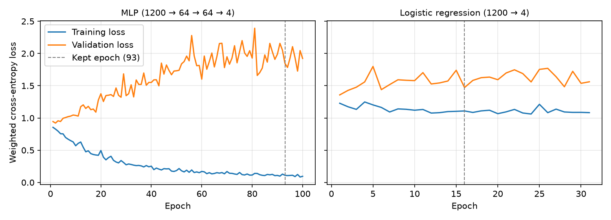

# Accelerometry Activity Viewer

A web app for viewing, annotating, and classifying raw wearable accelerometry. A small
neural network reads 4-second windows of the left-wrist signal and predicts the activity: walking, descending stairs, ascending stairs, or driving. The repository includes five held-out test participants and the trained model, so no dataset download is needed.

## Data

Raw tri-axial accelerometry (x, y, z in g, 100 Hz) from 32 healthy adults wearing four
ActiGraph sensors (left wrist, left hip, both ankles) while walking outdoors, climbing
stairs, and driving. Every sample has an activity label. The viewer shows signals
averaged to 25 Hz; the model uses the 100 Hz wrist signal.

## Features

- **Data Viewer:** browse participants (dropdown or ‹ › arrows), choose sensors,
  switch between stacked and overlay views or magnitude and x/y/z axes, and
  drag to zoom. **Run model** adds a *Predicted* band under the true activity labels,
  shows class probabilities on hover, and reports agreement with the true labels.
- **Model:** the main result, how the model works, MLP-vs-baseline scores,
  per-participant test scores, loss curves, and the test confusion matrix.
- **Train (optional challenges):** *interactive training* lets you change the hidden
  layers, units, activation, learning rate, dropout, and epochs. The *training monitor*
  shows live loss, accuracy, and macro-F1, then test results and a confusion
  matrix. A finished run can be used for Run model and reset to the saved model.
- **Annotation:** Mark an interval, add a label and an optional note, then edit or delete it.
- **Backend/database:** FastAPI with SQLite stores annotations and serves
  predictions, metrics, and training.

## Model

- **Input:** the raw 4-second left-wrist window, 400 samples × 3 axes = 1,200 numbers,
  scaled per axis using training-set statistics. Only windows that contain a single
  activity are used, with 50% overlap.
- **Network:** MLP 1,200 → 64 → 64 → 4 with ReLU and dropout 0.2 (81,284 parameters);
  softmax gives class probabilities.
- **Training:** Adam (learning rate 0.001, batch 128) on class-weighted cross-entropy,
  so rare stair windows count as much as driving windows. Early stopping keeps the
  epoch with the best validation macro-F1.
- **Baseline:** logistic regression (1,200 → 4), trained the same way.
- **Split:** by participant, 22 train / 5 validation / 5 test. The test participants
  are the ones in the viewer.

| Test set (5 unseen people) | Accuracy | **Error** | Macro-F1 |
|---|---|---|---|
| MLP | 89.7% | **10.3%** | 0.62 |
| Logistic regression baseline | 85.2% | 14.8% | 0.50 |

The MLP beats the baseline. Driving is almost always correct (99%). Walking and stairs
are often confused, because arm swing looks similar on both. The network overfits
(97.5% train vs. 87.5% validation accuracy), since an MLP has no notion of time in its
1,200 inputs. A 1D CNN is the planned next step.



## Run locally

Requires Node.js 22.12+ and Python 3.12+. From the project folder:

```sh
npm ci
python3.12 -m venv .venv
.venv/bin/python -m pip install -r backend/requirements.txt
```

Then run the backend and frontend in two terminals, and open the URL Vite prints:

```sh
.venv/bin/python -m uvicorn backend.app:app --host 127.0.0.1 --port 8000
```

```sh
npm run dev
```

To retrain the model, run `.venv/bin/python -m training.train`. It uses the included
`training/cache/windows.npz` and overwrites `backend/model/`. To rebuild from the raw
data, unzip the PhysioNet dataset into `data/physionet/`, then run
`scripts/preprocess.py` and `training.train --rebuild`. To run the tests, run
`.venv/bin/python -m unittest backend.test_app`.

## Libraries

React, Vite, Plotly, FastAPI, Pydantic, Uvicorn, SQLite, PyTorch, NumPy, pandas,
scikit-learn, and matplotlib.

## Data source and license

Karas, M., Urbanek, J., Crainiceanu, C., Harezlak, J., & Fadel, W. (2021).
[*Labeled raw accelerometry data captured during walking, stair climbing and driving*](https://physionet.org/content/accelerometry-walk-climb-drive/1.0.0/)
(version 1.0.0). PhysioNet. https://doi.org/10.13026/51h0-a262. Used under the
[Open Database License v1.0](https://physionet.org/content/accelerometry-walk-climb-drive/view-license/1.0.0/).

## AI assistance

Homework 1 was developed with help from the Codex agent. For Homework 2, Claude Code
(Anthropic) helped implement the neural network, training code, backend endpoints,
Model and Train tabs, interface redesign, and this README. The AI proposed options for
each design decision. I chose and approved each one: the task, the input, the split,
the architecture, training, the baseline, and the app integration. I reviewed the
resulting code and results.
