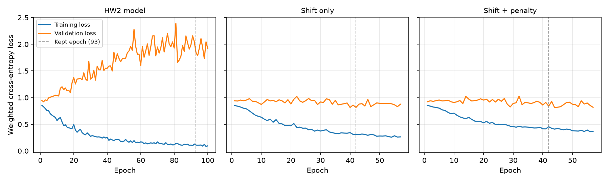

# Accelerometry Activity Viewer

This is my DS 7400 project. It's a web app for looking at accelerometer data from the wrist,
hip, and ankles, with a small neural network that guesses the activity from the left-wrist
signal: walking, going down stairs, going up stairs, or driving. The trained model and the data
for five test participants are included, so you don't need to download the dataset to run it.

## Data

The data come from a PhysioNet dataset of 32 healthy adults who wore four ActiGraph sensors
while walking outside, climbing stairs, and driving. Each sensor records x, y, and z
acceleration at 100 Hz, and every sample is labeled with the activity.

## What the app does

- Data Viewer: look through each test participant's signals and activity labels, add
  annotations, and click Run model to see the model's guesses under the real labels.
- Model: the network diagram, results, loss curves, and the Homework 3 experiment.
- Train: change the network's settings and retrain it while watching the loss (the two
  optional challenges from Homework 2).

Annotations are saved with a FastAPI backend and a SQLite database.

## Homework 2 model (the Homework 3 baseline)

The model is a small MLP. It takes a raw 4-second window of the wrist signal (400 samples
x 3 axes = 1,200 numbers), has two hidden layers of 64 units with ReLU and dropout, and has
4 outputs, one per activity.

```
1,200 inputs -> 64 (ReLU, dropout) -> 64 (ReLU, dropout) -> 4 outputs
```

I trained it with Adam and a class-weighted cross-entropy loss, and kept the epoch with the
best validation macro-F1. I split the data by person: 22 for training, 5 for validation, and
5 for testing. It gets 89.7% test accuracy, compared with 85.2% for logistic regression.

## Homework 3

The experiment summary is in [hw3/HW3 experiment summary.pdf](hw3/HW3%20experiment%20summary.pdf).

The HW2 model overfits. It gets about 97% on the training people and 87% on the validation
people, and the validation loss goes up almost right away. My guess was that it was
memorizing where in the window things happen, since every input has its own weights. When I
shifted test windows in time, it changed its answer about 12% of the time even though the
activity was the same.

So during training I shift each window by a random amount (0 to 4 seconds, wrapping the end
around to the start) and add a penalty to the loss when the prediction on the shifted window
is different from the original. The penalty is the squared difference between the two sets of
probabilities. I hoped this would make the model focus on the movement instead of the timing
and overfit less.

I compared three versions and trained each one three times:

1. the HW2 model
2. trained on shifted windows, no penalty
3. trained on shifted windows with the penalty

The second one is there so I can tell if a change comes from the penalty or just from the
shifted data.

To rerun the experiment (it takes about a minute):

```sh
.venv/bin/python -m training.hw3_experiment
```

The results are saved in `hw3/` and also show up in the app under Model, HW3 experiment.
The code is in `training/hw3_experiment.py` and `training/train.py`.

Test results, averaged over the 3 runs:

| Version | Test accuracy | Train - val gap | Changed after shift | Val loss |
|---|---|---|---|---|
| HW2 model | 88.9% | 8.6% | 11.8% | 1.61 |
| Shift only | 87.9% | 10.1% | 8.3% | 0.89 |
| Shift + penalty | 89.5% | 8.1% | 7.0% | 0.87 |



The penalty lowered how often the answer changed after a shift, from 11.8% to 7.0%. Shifting
also stopped the validation loss from going up, with or without the penalty. But test
accuracy and the gap between training and validation pretty much stayed the same, so timing
wasn't what was holding the model back. Most of the mistakes are still walking versus stairs,
which might just look too similar from the wrist. Next I'd like to try adding the ankle sensor
and a 1D CNN.

## Running it

You need Node.js 22.12+ and Python 3.12+. From the project folder:

```sh
npm ci
python3.12 -m venv .venv
.venv/bin/python -m pip install -r backend/requirements.txt
```

Then start the backend and the frontend in two terminals and open the address Vite prints:

```sh
.venv/bin/python -m uvicorn backend.app:app --host 127.0.0.1 --port 8000
```

```sh
npm run dev
```

To retrain the Homework 2 model, run `.venv/bin/python -m training.train`.

## Libraries

React, Vite, Plotly, FastAPI, SQLite, PyTorch, NumPy, pandas, scikit-learn, and matplotlib.

## Data source

Karas, M., Urbanek, J., Crainiceanu, C., Harezlak, J., & Fadel, W. (2021).
[Labeled raw accelerometry data captured during walking, stair climbing and driving](https://physionet.org/content/accelerometry-walk-climb-drive/1.0.0/)
(version 1.0.0). PhysioNet. https://doi.org/10.13026/51h0-a262. Used under the
[Open Database License v1.0](https://physionet.org/content/accelerometry-walk-climb-drive/view-license/1.0.0/).

## AI use

I used AI coding tools throughout this project. Homework 1 was built with help from Codex. For
Homeworks 2 and 3 I used Claude Code to help write the model, training, and app code, and to
brainstorm and run the Homework 3 experiment. I chose the task, the model setup, and the
Homework 3 idea, and I went through the code and results myself.
